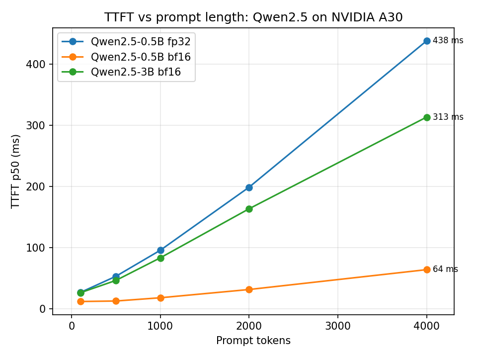

# inference-bench

Reproducible benchmarks for small open LLMs on a single NVIDIA A30. It measures output quality
(perplexity and bits-per-byte) and serving performance (time to first token, latency, throughput)
on the same models, and keeps the raw results next to the code.

Quality is one input to a deployment decision. Latency, throughput per GPU and cost per token also
depend on how the model is served, so the two sets of numbers are reported together.

## Contents

| What | Description | Files |
|---|---|---|
| Quality evaluation | Token-weighted perplexity, bits-per-byte, exact match and F1 with per-example records | `evalkit/metrics.py`, `run_quality.py`, `data/qa.jsonl` |
| TTFT sweep | Time to first token against prompt length, with a combined chart | `run_ttft_sweep.py`, `plot_ttft.py` |
| Server benchmark | Latency percentiles and throughput at 1 to 80 concurrent requests against an OpenAI-compatible endpoint | `scripts/benchmark_endpoint.py` |
| Machine report | GPU model, driver, compute capability, RAM | `scripts/machine_report.sh`, `results/machine_a30.txt` |

Raw outputs for every run are in `results/`.

## Setup

All numbers come from one NVIDIA A30 (24 GB, compute capability 8.0) that was shared with other
users; about 3 GB was in use by other processes during the runs. Software: PyTorch 2.5.1 (CUDA 12.1
build), transformers 4.46.3, and vLLM 0.31.0 for the server benchmark.

## Results

### Quality

Perplexity and bits-per-byte on 200 WikiText-2 test paragraphs (up to 512 tokens each), greedy
decoding for the QA check.

| Model | dtype | Role | Perplexity | Bits per byte |
|---|---|---|---|---|
| Qwen2.5-0.5B-Instruct | fp32 | reference | 21.998 | 1.0637 |
| Qwen2.5-0.5B-Instruct | bf16 | serving | 22.053 | 1.0645 |
| Qwen2.5-3B-Instruct | bf16 | serving | 13.350 | 0.8918 |

fp32 is the reference precision and bf16 is the precision the models are served in. Running the
0.5B model in both shows that precision changes perplexity by only 0.25%, so the gap between the
0.5B and 3B bf16 rows comes from model size, not dtype. The 3B was run in bf16 only.

All three runs score the same 35,729 tokens and 149,787 bytes, and repeated runs reproduce the
totals exactly.

A five-question QA set exercises the generation path end to end. Both models answer correctly but in
full sentences ("The capital of France is Paris."), and some answers reach the token limit, so exact
match is 0 for every run and F1 is about 0.24 (0.5B: 0.235, 3B: 0.236). With n=5 these numbers say
nothing about relative quality.

### Time to first token

Time to produce one token after a prompt of N tokens, which is the prefill cost. Hugging Face
transformers, batch size 1, greedy decoding, `torch.cuda.synchronize()` around each timing, 2
warm-up runs, median of 5 measured runs.

| Prompt tokens | 0.5B fp32 (ms) | 0.5B bf16 (ms) | 3B bf16 (ms) |
|---|---|---|---|
| 100 | 27.0 | 12.2 | 26.5 |
| 500 | 53.3 | 13.0 | 46.6 |
| 1000 | 95.9 | 18.3 | 83.5 |
| 2000 | 198.9 | 31.8 | 163.7 |
| 4000 | 438.0 | 64.2 | 313.5 |



bf16 is much faster than fp32 on the same model, 6.8x at 4000 tokens and 2.2x at 100 tokens, because
bf16 matrix multiplies run on the tensor cores. Below about 500 tokens the bf16 times are nearly
flat (12.2 to 13.0 ms for the 0.5B), which points to a fixed per-call overhead of about 12 ms rather
than compute. Above that, TTFT grows close to linearly with prompt length. The 3B model in bf16
processes 4000 tokens in 313 ms, about 12.8k tokens/s, which is roughly 70 TFLOPS against the card's
~165 TFLOPS bf16 peak (a rough estimate).

Across the five measured runs the spread is under 2% from 1000 tokens up. The 100-token rows and one
500-token bf16 run varied more.

### Throughput and latency under concurrency

Qwen2.5-3B-Instruct in bf16, served by vLLM 0.31.0. Each request has the same short prompt and
generates 64 tokens at temperature 0, so the workload is dominated by decoding. Concurrency 1, 5 and
20 used 100 requests per level; 40 and 80 used 200 requests in a separate run
(`results/systems_qwen3b_a30_bf16_high_conc.json`).

| Concurrent requests | Latency p50 (s) | Latency p95 (s) | Throughput (tok/s) | Scaling vs 1 | Per-user (tok/s) |
|---|---|---|---|---|---|
| 1 | 0.632 | 0.634 | 101.3 | 1.0x | 101 |
| 5 | 0.660 | 0.671 | 481.7 | 4.8x | 97 |
| 20 | 0.719 | 0.744 | 1750.8 | 17.3x | 89 |
| 40 | 0.754 | 0.803 | 3281.1 | 32.4x | 85 |
| 80 | 0.919 | 0.983 | 4626.5 | 45.7x | 70 |

Per-user rate is 64 tokens divided by p50 latency.

Going from 1 to 20 concurrent requests multiplies throughput by 17.3 while p50 latency rises 14%
(0.632 s to 0.719 s). With one request, each output token takes about 9.9 ms (101 tok/s), roughly
two thirds of the ~150 tok/s that reading the 6.2 GB of weights at 933 GB/s would allow
(back-of-envelope). Decoding is limited by memory bandwidth, so one read of the weights serves every
request in the batch and extra requests add little cost.

Past 20 requests the gains shrink. Throughput is 32x the single-request rate at 40 requests (81% of
linear) and 46x at 80 (57%), and p50 latency rises to 0.75 s and 0.92 s. Throughput was still
increasing at 80, so saturation was not reached. At 40 concurrent requests each stream still gets
about 85 tok/s, and at 80 about 70 tok/s. Two runs with 20 and 100 requests per level agree within
1% at 1 and 5 concurrent requests.

Taken together, prefill is compute-bound and scales with prompt length, while decode is
bandwidth-bound and batches well, so the two phases respond to different changes in hardware and
configuration.

## Method

- Perplexity is exp(total NLL / total tokens), with sums accumulated across batches and one
  division at the end. Padding is excluded from both numerator and denominator.
- Bits-per-byte divides the same total NLL by the UTF-8 bytes of the scored tokens, which allows
  comparison between models with different tokenizers on the same text.
- Generation uses left padding and scoring uses right padding. Prompts are sliced off before
  decoding.
- The metrics were checked against reference implementations (`F.cross_entropy` with
  `ignore_index`, the Hugging Face model's own loss, batched vs single-example scoring).

## Limitations

- The QA set has 5 items, so quality conclusions rest on perplexity and bits-per-byte.
- One GPU, shared with other users, on one machine.
- TTFT was measured with Hugging Face at batch size 1, not in vLLM. The decode and concurrency
  numbers come from vLLM.
- The server benchmark measures non-streaming end-to-end latency, so TTFT and per-token time are not
  separated.
- Server-benchmark prompts are short and identical, so prefix caching makes prefill nearly free
  there.
- Concurrency stops at 80 with throughput still rising. At 80 requests in flight, 200 requests is
  only 2.5 waves, so ramp-up and tail effects weigh more than at lower levels.

## Reproducing

```bash
pip install torch==2.5.1 --index-url https://download.pytorch.org/whl/cu121   # for CUDA 12.2 drivers
pip install -r requirements.txt

python3 run_quality.py Qwen/Qwen2.5-0.5B-Instruct fp32
python3 run_quality.py Qwen/Qwen2.5-0.5B-Instruct bf16
python3 run_quality.py Qwen/Qwen2.5-3B-Instruct bf16

python3 run_ttft_sweep.py                          # 0.5B, fp32 (default)
python3 run_ttft_sweep.py --dtype bf16
python3 run_ttft_sweep.py --model Qwen/Qwen2.5-3B-Instruct --dtype bf16
python3 plot_ttft.py                               # combined chart from the three runs
```

The quality and TTFT runs need free GPU memory, so stop the inference server first. For the server
benchmark, start a vLLM OpenAI-compatible server for Qwen/Qwen2.5-3B-Instruct in bf16 on port 8001,
then run:

```bash
python3 scripts/benchmark_endpoint.py --endpoint http://localhost:8001/v1 \
  --model Qwen/Qwen2.5-3B-Instruct --concurrency-levels 1 5 20 --requests-per-level 100 --max-tokens 64
python3 scripts/benchmark_endpoint.py --endpoint http://localhost:8001/v1 \
  --model Qwen/Qwen2.5-3B-Instruct --concurrency-levels 40 80 --requests-per-level 200 --max-tokens 64
```

## Planned work

- A concurrency sweep past 80 requests to find saturation.
- A comparison across models, precisions and runtimes, including Nemotron 3 Nano 4B.
- A sizing and cost calculator checked against these measurements.
- TensorRT-LLM compared with vLLM.
- A larger QA set with a contains-answer metric.
